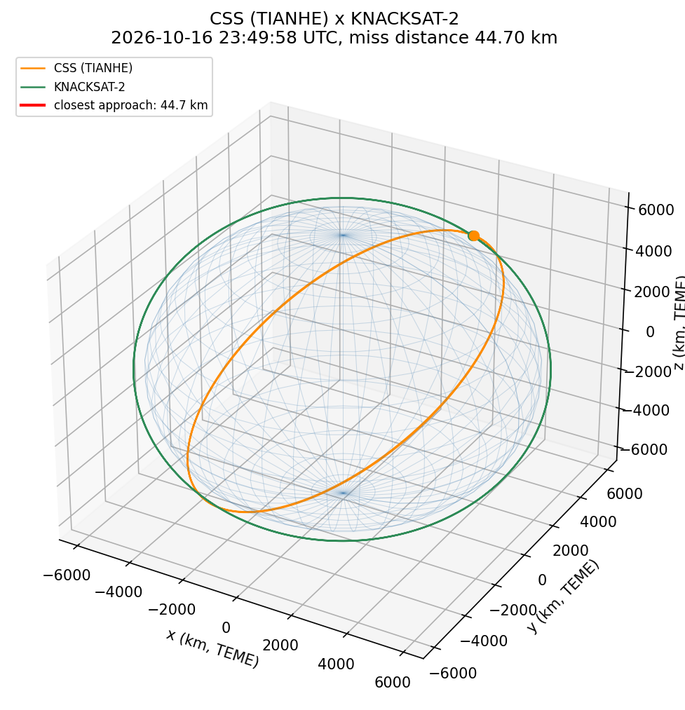

# Conjunction Screener

A small Python tool that screens satellites for **close approaches**
(conjunctions) using public orbit data. It downloads two-line element sets
(TLEs) from [CelesTrak](https://celestrak.org), propagates the orbits with
**SGP4**, finds the moments where two objects pass closest to each other,
and plots the closest encounter in 3D.

This is a **learning project**, built out of a personal interest in space
situational awareness (SSA) and space safety. It is geometry-only: no
covariance, no probability of collision, no operational use.

## What it does

- Parses and downloads TLEs (CelesTrak groups: `stations`, `starlink`, `active`)
- Propagates each object on a time grid with SGP4 (TEME frame)
- Screens every pair for local distance minima on the time grid
- Refines each minimum with a golden-section search (sub-second timing),
  then keeps the ones under the threshold
- Plots the closest pair around Earth with the miss distance marked

## Quickstart

```bash
pip install -r requirements.txt

# offline: uses the bundled CelesTrak "stations" snapshot (2026-10-15)
python examples/run_screening.py

# live data
python examples/run_screening.py --live stations --hours 24 --threshold 50
```

Example output:

```
Using the bundled sample TLEs (CelesTrak 'stations' snapshot, 2026-10-15).
Merged 7 object(s) sharing one orbit (e.g. docked station modules).
10 objects. Screening 45 pairs over 24 h ...

1 close approach(es) under 50 km:
  2026-10-16 23:49:58 UTC     44.70 km  (alt ~ 361.9 km)  CSS (TIANHE)  x  KNACKSAT-2

Closest pair: 2026-10-16 23:49:58 UTC     44.70 km  (alt ~ 361.9 km)  CSS (TIANHE)  x  KNACKSAT-2
Plot written to examples/closest_approach.png
```



## Tests

```bash
python -m pytest tests/ -v
```

Tests run fully offline against the bundled TLE snapshot.

## Project layout

```
src/conjunction_screener/
    tle.py          TLE parsing + CelesTrak download
    propagate.py    SGP4 propagation to ECI (TEME) positions
    screen.py       pairwise close-approach screening + refinement
    visualize.py    3D plot of the closest encounter
    data/           bundled sample TLEs (offline tests/demo)
examples/run_screening.py   command-line demo
tests/                      pytest suite (offline)
```

## Honest limitations

- TLEs are public, low-accuracy data; errors of several km are normal.
- The screening is pure geometry: it finds *where* objects pass close, not
  *how likely* a collision is. Operational systems (e.g. the ones space
  safety companies build) add uncertainty propagation and collision
  probability.
- Very brief encounters can still be missed if the dip is so narrow that
  the coarse grid shows no local minimum near it; a 60 s step is a
  compromise between speed and completeness.

## Data source

TLE data: [CelesTrak](https://celestrak.org/NORAD/elements/), published by
the US Space Command / 18th Space Defense Squadron.
